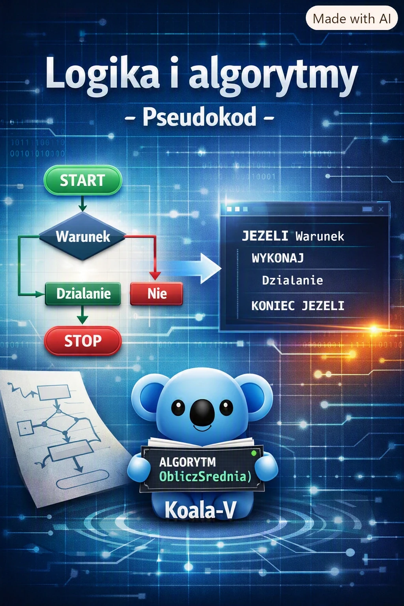
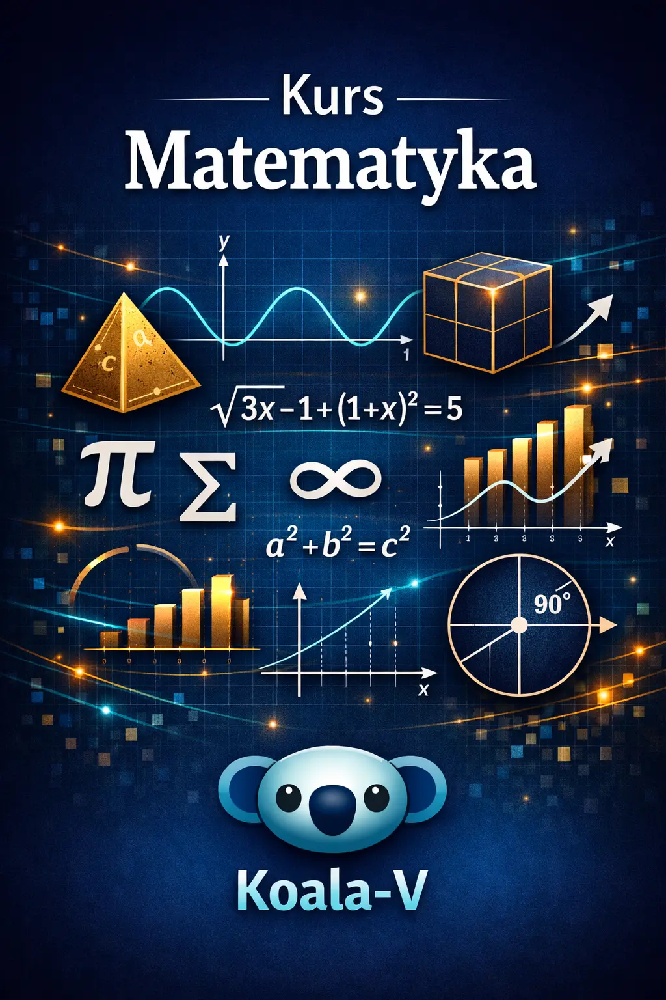
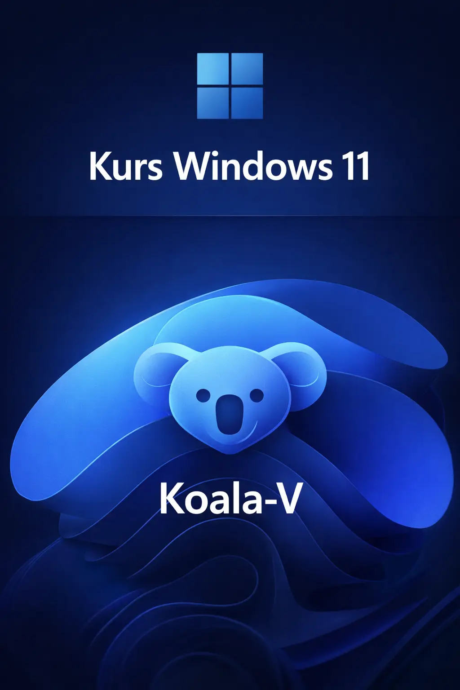
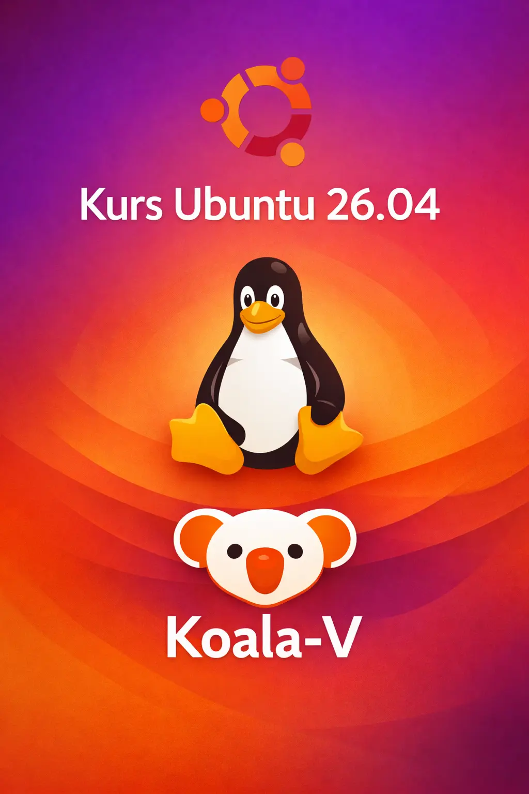

  <h1 class="display-3 gradient-text-primary fw-900 mb-3">Witaj w Kursie Binarne Fundamenty IT!</h1>
  
Od fizyki pojedynczego bitu i bramek logicznych po arytmetykę procesora.

Komputer przetwarza wyłącznie dyskretne sygnały elektryczne: stan wysoki ($1$) oraz niski ($0$). W procesorze i pamięci RAM nie ma liter, obrazów, liczb ujemnych ani ułamków. Wszystko, co widzisz na ekranie, to reguły układania bitów przetwarzanych przez sieć przełączników logicznych.

Zbudujesz konkretne odruchy i modele myślowe, które wykorzystasz w programowaniu, sieciach i diagnostyce systemów.

---

## Gdzie ta wiedza działa w praktyce

- **Egzaminy zawodowe i techniczne**: Zadania z kwalifikacji INF.02, INF.03, INF.04 oraz matury z informatyki wymagają natychmiastowego przeliczania systemów liczbowych, algebry Boole'a, kodu U2 oraz flag procesora.
- **Kryptografia i algorytmy**: 
  - Przesunięcia kodów ASCII w szyfrach podstawieniowych i monoalfabetycznych.
  - Bramka XOR jako fundament szyfrowania symetrycznego (One-Time Pad, szyfry blokowe i strumieniowe).
  - Operacja modulo (`%`) na potęgach liczb jako matematyczna podstawa asymetrycznego szyfrowania RSA i wymiany kluczy Diffiego-Hellmana.
- **Uniwersalny zapis kolorów (HEX)**: Kody barw we frontendzie, grafice i silnikach gier (`#RRGGBB`). To 24 bity podzielone na 3 bajty po 8 bitów na kanał (Red, Green, Blue). Wartości od `$00$` do `$FF$` to w dziesiętnym dokładnie zakres od $0$ do $255$.
- **Adresacja sieciowa klasowa i bezklasowa (VLSM)**: 
  - Adres IPv4 to dokładnie 32 bity ułożone w 4 oktety.
  - Maska podsieci to ciąg kolejnych jedynek (`/24` to 24 jedynki: `255.255.255.0`).
  - Adres sieci wyznacza się sprzętową operacją bitową AND na adresie IP i masce.
  - Dostępną liczbę hostów obliczasz ze wzoru na potęgę dwójki: $2^{32 - \text{prefix}} - 2$.

---

## Haczyki myślowe, które budujesz w tym kursie

### Pomiary, pamięć i wagi

- **Dzielnik 8**: Bit transmisyjny ($b$) to nie bajt pamięci ($B$). Łącze 800 Mb/s pozwala pobierać pliki z prędkością do 100 MB/s.
- **Pojemność dysków (GB a GiB)**: Producenci liczą w potęgach dziesięciu ($10^9$), a systemy operacyjne w potęgach dwójki ($2^{30}$). Dlatego nośnik 64 GB ma w systemie 59.6 GiB.
- **Metoda wag w pamięci**: Znajomość ciągu wag ($1, 2, 4, 8, 16, 32, 64, 128...$) pozwala rozkładać i sumować liczby binarne w ułamku sekundy bez kalkulatora.
- **Paczki bitów (Baza 8 i 16)**: System ósemkowy to triady (paczki po 3 bity, prawa dostępu w Linuksie `rwx`), a szesnastkowy to tetrady (paczki po 4 bity, kolory HEX i adresy pamięci RAM).

### Bramki i układy logiczne

- **Bramka XOR jako suma bez przeniesienia**: Działa jak odwracalny przełącznik ($A \oplus B \oplus B = A$), dodaje dwa bity i stanowi rdzeń szyfrów oraz sumatorów.
- **Bramka NAND jako uniwersalny budulec**: Z samych bramek NAND można zbudować każdą inną bramkę logiczną i całą strukturę procesora.
- **Brak odejmownika w krzemie**: Procesor nie buduje osobnego układu do odejmowania. Inwertuje bity i dodaje jeden ($\neg A + 1$), realizując odejmowanie na zwykłym sumatorze w kodzie U2.

### Rejestry i arytmetyka procesora

- **Ujemna waga najstarszego bitu**: W kodzie U2 bit MSB ma wagę ujemną (dla bajtu to $-128$, a pozostałe $+64 \dots +1$), co rozwiązuje problem znaku bez dublowania zera.
- **Przeniesienie a przepełnienie (Flagi CF i OF)**: Flaga Carry (CF) pilnuje wyjścia poza zakres dla liczb bez znaku, a flaga Overflow (OF) wykrywa błąd znaku w kodzie U2, gdy dodanie dwóch liczb dodatnich daje wynik ujemny.
- **Mnożenie i dzielenie przez przesuwanie bitów**: Zamiast wolnych operacji arytmetycznych kompilator przesuwa bity: `x * 4` to przesunięcie w lewo `x << 2`, a dzielenie przez dwa to przesunięcie w prawo `x >> 1`.
- **Siatka ekranu i bufory kołowe**: Operator modulo (`%`) zapętla pozycje w buforze cyklicznym `(i + 1) % ROZMIAR` oraz przelicza płaski indeks pamięci na współrzędne 2D: `wiersz = i / SZEROKOSC`, `kolumna = i % SZEROKOSC`.

### Kodowanie tekstu i ułamków

- **Wielkość liter jednym bitem (ASCII)**: Różnica między 'A' (65) a 'a' (97) to dokładnie bit o wadze 32 ($2^5$). Zmiana wielkości znaku to pojedyncza operacja `XOR 0x20`.
- **Niedokładność ułamków (IEEE 754)**: Ponieważ $0.1$ w systemie binarnym jest nieskończonym ułamkiem okresowym, procesor zapisuje go w formacie float ze skończoną mantysą, przez co w kodzie `0.1 + 0.2 != 0.3`.

---

## Kolejne kursy po tym

Po opanowaniu podstaw binarnych rozwiń swoje umiejętności w obszarach sieci, algorytmiki lub architektury sprzętu:

<ul class="courses-list" style="display: grid; grid-template-columns: repeat(auto-fit, minmax(240px, 1fr)); gap: 20px; list-style: none; padding: 0; margin-top: 20px;">
  <li style="display: flex;">
    <a class="card course-card" href="/courses/podstawy-sieci-komputerowych/" style="text-decoration: none; width: 100%; display: flex; flex-direction: column;">
      

        
      

      

        
Sieci Komputerowe

        
Poznasz dziedzinę informatyki dzięki której komputery mogą się ze sobą komunikować

      

    </a>
  </li>
  <li style="display: flex;">
    <a class="card course-card" href="/courses/logika-i-algorytmy-pseudokod/" style="text-decoration: none; width: 100%; display: flex; flex-direction: column;">
      

        
      

      

        
Programowanie blokowe i pseudo kod

        
Poznasz schematy na bazie których zbudowane są wszystkie języki programowania 

      

    </a>
  </li>
  <li style="display: flex;">
    <a class="card course-card" href="/courses/urządzenia-techniki-komputerowej/" style="text-decoration: none; width: 100%; display: flex; flex-direction: column;">
      

        
      

      

        
Urządzenia techniki komputerowej

        
Poznanie podzespołów komputera i urządzeń peryferyjnych

      

    </a>
  </li>
</ul>

---

## Inne kursy

Na podobnym poziomie od podstaw możesz wejść w te kursy:

<ul class="courses-list" style="display: grid; grid-template-columns: repeat(auto-fit, minmax(240px, 1fr)); gap: 20px; list-style: none; padding: 0; margin-top: 20px;">
  <li style="display: flex;">
    <a class="card course-card" href="/courses/matematyka/" style="text-decoration: none; width: 100%; display: flex; flex-direction: column;">
      

        
      

      

        
Matematyka

        
Język wzorców, potęgi, notacja naukowa, logika Boole'a, teoria mnogości i wiele więcej.

      

    </a>
  </li>
  <li style="display: flex;">
    <a class="card course-card" href="/courses/windows-11/" style="text-decoration: none; width: 100%; display: flex; flex-direction: column;">
      

        
      

      

        
Windows 11

        
Administracja systemem, partycjonowanie dysków, uprawnienia i rejestr.

      

    </a>
  </li>
  <li style="display: flex;">
    <a class="card course-card" href="/courses/ubuntu-26/" style="text-decoration: none; width: 100%; display: flex; flex-direction: column;">
      

        
      

      

        
Ubuntu 26 Desktop

        
Praca w terminalu GNU/Linux, uprawnienia POSIX, pakiety i procesy.

      

    </a>
  </li>
</ul>
