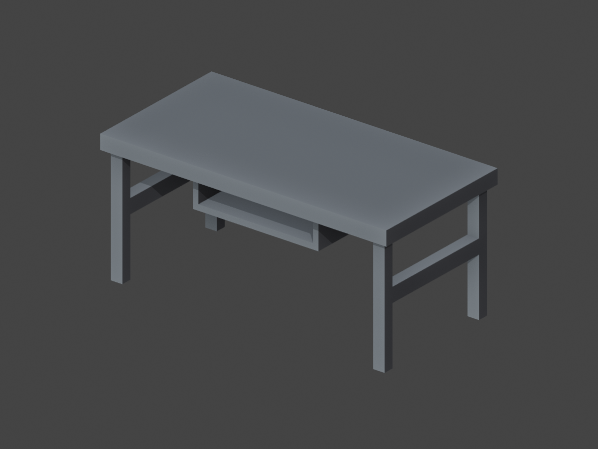
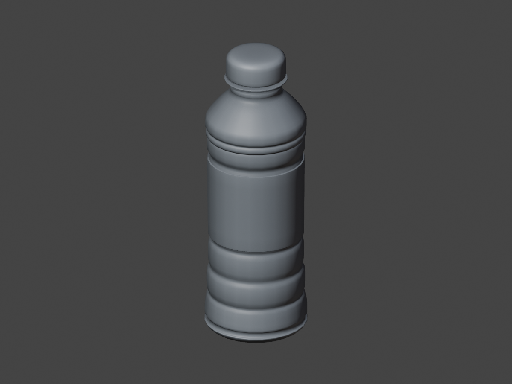
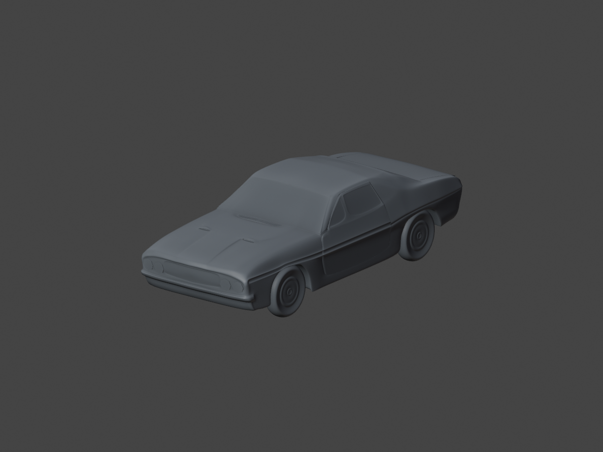

# Inspekcja projektów autora w Blenderze 5.2.2 LTS

Data: 2026-10-16. Źródła: `C:\Users\rudek\Desktop\blender come back\KURS`.

## Metoda i zakres

Otworzono `stół.blend`, `butelka.blend` i `dodge.blend` w zainstalowanym Blenderze 5.2.2 LTS przez alias Microsoft Store. Automatyczne wykonywanie skryptów zawartych w projektach było wyłączone. Inspekcja nie wymagała zmiany praw dostępu do WindowsApps ani ponownej instalacji Blendera.

Wykonano odczyt danych przez Python API i kontrolę siatki przez BMesh, ocenę po modyfikatorach w konfiguracji viewportu oraz dziewięć podglądów Workbench. Kontrolowano jednostki, skalę, hierarchię, materiały, UV, ścieżki obrazów i wybrane cechy topologii. Stół zapisano w trybie Edit; przed odczytem zsynchronizowano jego dane przez przejście do Object Mode wyłącznie w pamięci procesu.

Suma SHA-256 każdego oryginału przed i po inspekcji jest identyczna. Nie zapisano zmian do źródłowych `.blend`. Wszystkie zmiany potrzebne do kamer podglądu istniały wyłącznie w pamięci.

Podglądy używają jednego neutralnego koloru. Pokazują kształt i cieniowanie geometrii, a nie poprawność tekstur lub fizycznych materiałów. Brak błędów lokalnego windingu nie potwierdza automatycznie, że wszystkie zamknięte powierzchnie są skierowane na zewnątrz. Nie badano jeszcze wszystkich samoprzecięć, duplikatów, pokrywania UV, eksportu ani działania modeli w silnikach.

## Pomiary zbiorcze

Wymiary to obwiednia obiektów siatkowych widocznych w viewport, z uwzględnieniem transformacji, modyfikatorów i jednostek sceny. Wszystkie sceny mają Metric i Unit Scale 1. Wartości zaokrąglono; statystyki dotyczą instancji obiektów, więc współdzielone koła są liczone w obu miejscach sceny.

| Model | Obwiednia X × Y × Z | Obiekty mesh | Trójkąty po aktywnych modyfikatorach viewportu |
| --- | --- | --- | --- |
| Stół | 2,00 × 1,00 × 0,90 m | 1 | 516 |
| Butelka | 0,625 × 0,625 × 1,770 m | 3 | 7 440 |
| Dodge | 1,301 × 3,295 × 0,944 m | 9 | 82 072 |

Wszystkie obiekty siatkowe w tych plikach mają skalę (1,1,1). Nie oznacza to poprawnego wymiaru fizycznego: butelka może mieć jednostkową skalę obiektu i nadal być znacznie większa od zamierzonej butelki sklepowej.

## Stół

Bryła nadaje się do pierwszej lekcji: ma czytelny blat, nogi i poprzeczki oraz rzeczywiste wymiary warsztatowego stołu. Siatka bazowa ma 80 wierzchołków, 65 czworokątów i 130 trójkątów. Mirror działa na X i Y z Clipping i Merge.

Po Mirror występują **44 krawędzie brzegowe i 8 krawędzi przylegających do trzech ścian**. Osiem problematycznych krawędzi leży na płaszczyźnie lokalnej Y=0, przy poprzeczce w rejonie lokalnego Z od −0,45 do −0,35 m. To konkretne miejsce do przeglądu w Edit Mode. Podejrzenie: pozostawiona ściana kończąca element na płaszczyźnie lustra. Sam pomiar nie zastępuje wskazania ściany i potwierdzenia poprawki na kopii.

Nie należy zalecać globalnego Merge by Distance jako automatycznej naprawy. Próg zbyt duży może połączyć zamierzone detale, a samo scalanie nie usuwa wszystkich wewnętrznych ścian.

Warstwa UV istnieje, lecz **24 z 65 ścian mają zerowe pole w UV**. Model nie ma przypisanego materiału. To poprawny punkt startowy nauki modelowania, ale nie gotowy asset z teksturami.

Ćwiczenie rozwijające: znaleźć wadliwe miejsce na płaszczyźnie symetrii, wyjaśnić związek z Mirror, poprawić kopię, powtórzyć licznik i ocenić wynik od spodu. Potem wykonać UV z checkerem i prosty materiał. Nie wymagać w pierwszym ćwiczeniu kompletnej produkcyjnej oprawy.

## Butelka

Model jest rozdzielony na korpus, pas etykiety i korek. To użyteczne do nauki separacji oraz przypisywania materiałów. Rzeczywista wysokość całego zestawu wynosi około **1,77 m**, a nie typowy rozmiar ręcznej butelki. W kursie trzeba odczytać docelowy wymiar z referencji i dopiero wtedy przeskalować cały zestaw. Nie dopasowywać części niezależnie na oko.

Korpus `Plane` ma 769 wierzchołków i 1 524 trójkąty bazowe; aktywny Subdivision zwiększa wynik do 6 120 trójkątów. Pas etykiety ma 480, a korek 840 trójkątów. Cały zestaw daje 7 440. Sam ten koszt nie rozstrzyga przydatności: potrzebna jest kamera i liczba kopii w scenie.

**Wszystkie 768 ścian korpusu ma zerowe pole UV.** Etykieta i korek mają niezerowe UV, jednak UV korka wychodzi poza zakres 0–1 w osi U. Może to być celowe przy materiale powtarzalnym, ale nie jest gotowym układem pod dowolny unikalny bake. Nie przeprowadzono pełnego pomiaru nakładania wysp ani rozciągania.

Po aktywnych modyfikatorach korpus ma 24 krawędzie brzegowe, etykieta 48, a korek 24. Otwarty pas etykiety lub niewidoczny brzeg korka nie jest automatycznie wadą. Trzeba obejrzeć, gdzie kończy się powierzchnia, czy brzeg widać przy docelowej kamerze i jak działa backface culling. Dla przezroczystej butelki grubość i wnętrze wymagają odrębnego projektu materiału.

### Brakujące obrazy i przyczyna

Obrazy `37008944.jpg` oraz `depositphotos_253281792_l-768x388.jpg` wskazują względnymi ścieżkami do `AppData/Local/Temp`. Oba są niespakowane, nie istnieją pod zapisanymi ścieżkami i po otwarciu mają rozmiar 0×0. Pierwszy jest używany przez węzeł Image Texture w materiale pasa etykiety.

Autor potwierdził, że obraz został przeciągnięty bezpośrednio z Firefoksa. W sesji był dostępny w pamięci, ale nie został trwale dostarczony z projektem. To błąd przenośności zależności, nie modelowania.

Ćwiczenie naprawcze powinno prowadzić przez odzyskanie właściwego obrazu, zapis w trwałym folderze, ponowne powiązanie, wybór ścieżek względnych lub Pack Resources i test po ponownym otwarciu. Pack Resources nie odzyska automatycznie obrazu, którego dane już nie są dostępne. Dla paczki do silnika trzeba osobno dostarczyć wymagane tekstury eksportowe; samo spakowanie do `.blend` nie dowodzi poprawnego eksportu.

Bump korka jest zbudowany proceduralnie z Wave Texture, Color Ramp, UV Map i Bump. To dobry przykład różnicy między shaderem Blendera a mapą przeznaczoną do eksportu. Materiał korpusu ma Alpha około 0,6 i Transmission Weight 0; nie jest to jeszcze dowód poprawnie skonfigurowanego przezroczystego tworzywa w silniku.

## Dodge

Karoseria jest rozpoznawalna i stanowi sensowną bazę ćwiczenia z formy. Podglądy potwierdzają nierówny przebieg cieniowania w pobliżu wlotów maski i podszybia, bardzo miękkie przejścia części powierzchni oraz uproszczone reflektory i koła. Nie można określić jednej przyczyny każdego artefaktu wyłącznie z obrazu; potrzebny jest test zmian geometrii i modyfikatorów.

Obwiednia ma około **3,295 m długości**, podczas gdy istniejąca lekcja przyjmuje referencję około 4,86 m. Sam Unit Scale 1 nie zapewnił zgodności. Dla przyjętej w lekcji długości współczynnik jednolitej korekty wyniósłby około 1,475, ale przed zmianą trzeba zatwierdzić wymiar konkretnej referencji oraz zakres obwiedni. Transformować należy cały zestaw i sprawdzić pivoty.

Główna karoseria `Plane` ma 2 008 wierzchołków i 3 839 trójkątów bazowych. Stos to Mirror → Subdivision → Solidify → Weighted Normal. Subdivision ma poziom 1 w viewport i 2 w renderze. Karoseria po modyfikatorach viewportu ma **62 048 trójkątów**. Solidify ma grubość **0,001 m**, natomiast tylna klapa i `pasek_boczny.001` mają 0,01 m. Trzeba ustalić, czy ta różnica jest zamierzona; nie zamieniać jej od razu na jedną wartość bez briefu.

Cały model ma 82 072 trójkąty w konfiguracji viewportu. To wynik innego stanu pliku niż liczba 83 816 widoczna na wcześniejszym zrzucie. W lekcji każda statystyka musi określać wersję pliku i poziomy modyfikatorów. Nie utożsamiać tego wyniku z kosztem eksportu ani renderu: część stosów ma odmienne przełączniki i poziomy dla renderu.

### Siatka i UV

Karoseria bazowa ma 181 krawędzi brzegowych, lecz po stosie wynikowa karoseria ma **0 krawędzi brzegowych** i 0 krawędzi współdzielonych przez więcej niż dwie ściany. Solidify zamyka obrys. Bazowych otwarć nie wolno opisywać jako dowodu dziurawej finalnej karoserii.

Inne elementy mają otwarte brzegi także po modyfikatorach viewportu: koła po 64, `gril.001` 276, `Plane.001` 48. Wymagają lokalnego przeglądu. Dla `Plane.001` Solidify i Subdivision są wyłączone w viewport, ale włączone w renderze, co tłumaczy część różnic między podglądami.

UV nie jest przygotowane do teksturowania całego auta. Przykłady zerowego pola UV: karoseria 843/1 913 ścian, `Plane.001` 56/56, `gril.001` 136/239, `pasek_boczny.001` 137/206. Sama obecność warstwy `UVMap` nie oznacza ukończonego unwrapu.

### Materiały, hierarchia i blueprint

Karoseria nie ma przypisanych slotów materiałowych. Dwa materiały metalu i gumy występują na kołach. Zapisana scena nie potwierdza zatem wykonania rozdziału lakier/szyby/reflektory opisanego w lekcji.

Wszystkie dziewięć obiektów siatkowych ma `parent = None`. Dwa obiekty kół współdzielą dane `Cylinder.002`, każdy ma też Mirror względem karoserii. To przykład współdzielenia geometrii, ale nie cztery niezależne węzły kół gotowe do sterowania. Nie zrealizowano w tej wersji relacji rodzicielskich opisywanych w lekcji. Otwierane drzwi wymagają dodatkowej kontroli rozdzielenia i pivotów.

Blueprint jest zapisany jako obraz TILED z wzorcem `dodge-challenger-<UDIM>.png`, kafelkiem 1970 i rozmiarem 2210×2225. **Plik `dodge-challenger-1970.png` istnieje i został rozpoznany.** Numer roku został potraktowany jako numer kafelka. Nie jest to brakujący obraz; literalne sprawdzenie ścieżki zawierającej `<UDIM>` dałoby fałszywy alarm. Dla zwykłej pojedynczej referencji warto uprościć nazwę i świadomie wybrać źródło obrazu, ale nie wymaga to naprawy utraconej tekstury.

## Kolejność pracy dydaktycznej

1. Zapis i zależności: przykład etykiety z Firefoksa, trwała lokalizacja i ponowne otwarcie.
2. Jednostki i wymiary: porównanie poprawnego rozmiaru stołu z powiększoną butelką oraz pomniejszonym autem.
3. Object/Edit i Mirror: naprawa krawędzi stołu na płaszczyźnie symetrii, bez masowego scalania.
4. Siatka i UV: checker, wykrywanie zapadniętych ścian UV oraz ocena otwartych brzegów w kontekście funkcji obiektu.
5. Pierwszy mały asset z własnymi teksturami i importem do silnika.
6. Powrót do Dodge’a: poprawa jednego panelu, kontrola refleksów, nowa siatka docelowa, UV, bake i materiały. Dopiero potem mechanika części i optymalizacja.

Nie należy automatycznie „naprawiać wszystkiego” w oryginałach: zniknęłyby stany początkowe do ćwiczeń, a niektóre otwarte powierzchnie są zamierzone. Z oryginałów przygotujemy opisane kopie startowe, kontrolne i rozwiązania.

## Dowody i odtwarzalność

W podkatalogu `inspection` znajdują się raporty JSON i trzy neutralne widoki każdego modelu. Skrypt `inspect_blends.py` zapisuje statystyki oraz skróty źródeł. Raporty mają `source_unchanged: true`; `complete.json` nie zawiera błędów wykonania.

Inspekcja nie jest jeszcze próbą eksportu do Unity, UE5 lub Godota ani pełnym odbiorem jakości assetu. Ustalenia zastępują wcześniejszą informację „nie otwarto plików w Blenderze” w dokumentacji etapu planowania.
